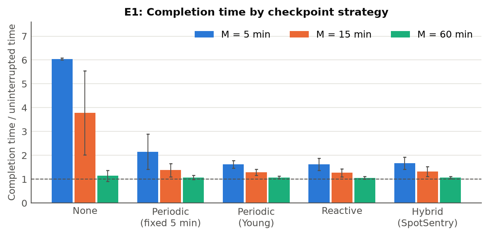
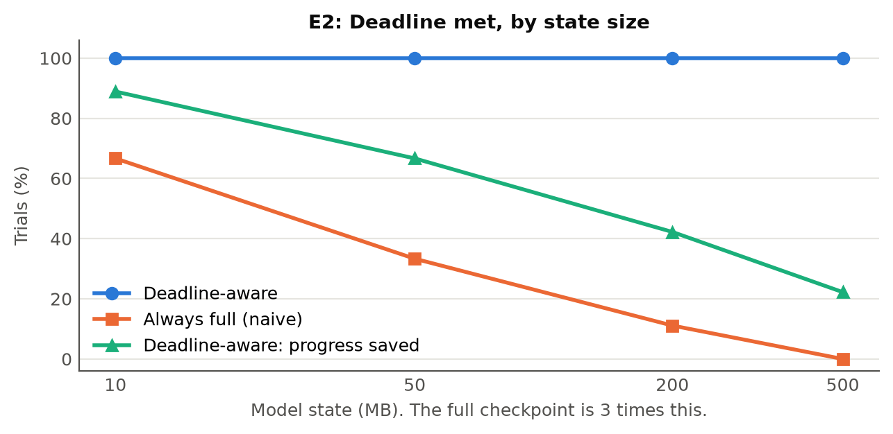
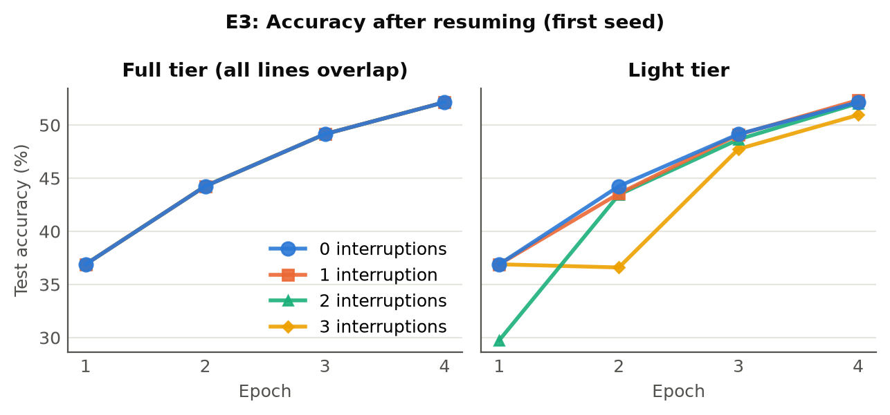
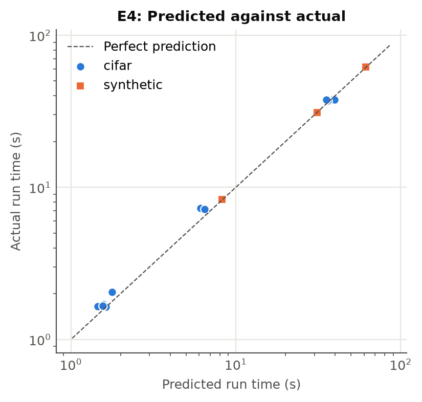
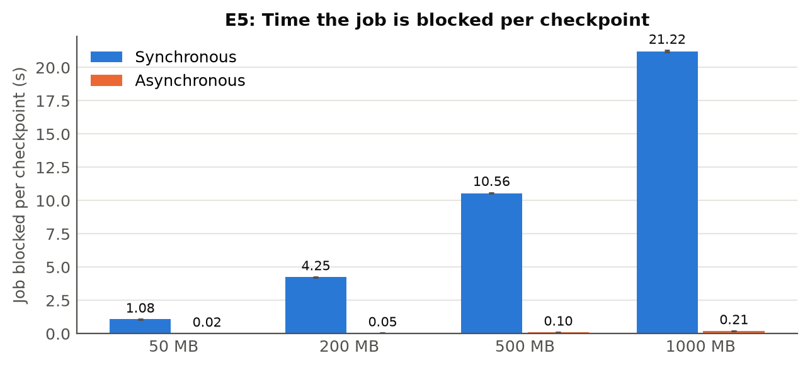
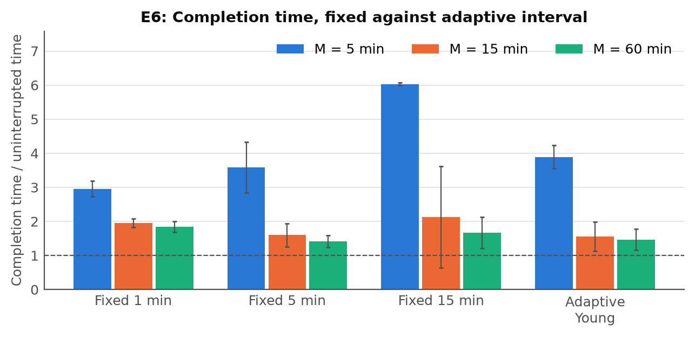

# Experiment results

Generated by `python experiments/analyze.py` on 2026-11-07. Every number here comes from the CSVs in
`experiments/results/`. Run the experiments again and regenerate this file; do not edit it by hand.

**Setup.** Workers ran as local processes on one laptop (12 logical CPUs, 15.5 GB RAM, Windows 11),
with a filesystem store whose uploads are limited by SpotSentry's own throttle, and a local
metadata service. These are not results from AWS. Interruptions are drawn from an exponential
distribution with mean M, using a fixed seed, so every strategy faces the same interruption times.

**Time scaling (E1, E6).** All times are divided by 30: a 30-minute job takes 60 s, a 2-minute
notice 4 s, a 3-minute replacement boot 6 s. Python's start-up time is not scaled, which penalises
every strategy that restarts more often.

## E1: which checkpoint strategy is best?

| mtbi | strategy | completed | time / ideal | lost work (s) | overhead % | restarts | cost / on-demand |
|---|---|---|---|---|---|---|---|
| short | hybrid | 5/5 | 1.67 +/- 0.25 | 0.00 +/- 0.00 | 2.00 +/- 0.06 | 5.0 +/- 2.1 | 0.47 +/- 0.02 |
| short | none | 0/5 | 6.04 +/- 0.04 | 234.36 +/- 20.19 | 0.00 +/- 0.00 | 15.2 +/- 1.5 | 1.78 +/- 0.05 |
| short | periodic_fixed_5min | 5/5 | 2.15 +/- 0.73 | 28.23 +/- 21.20 | 0.09 +/- 0.03 | 5.6 +/- 3.3 | 0.64 +/- 0.16 |
| short | periodic_young | 5/5 | 1.63 +/- 0.16 | 1.53 +/- 0.42 | 1.61 +/- 0.17 | 4.2 +/- 1.3 | 0.48 +/- 0.02 |
| short | reactive | 5/5 | 1.62 +/- 0.25 | 0.00 +/- 0.00 | 0.57 +/- 0.17 | 5.0 +/- 2.1 | 0.45 +/- 0.02 |
| medium | hybrid | 5/5 | 1.32 +/- 0.21 | 0.00 +/- 0.00 | 1.40 +/- 0.04 | 2.2 +/- 1.8 | 0.44 +/- 0.01 |
| medium | none | 4/5 | 3.79 +/- 1.76 | 125.88 +/- 84.69 | 0.00 +/- 0.00 | 5.8 +/- 3.5 | 1.28 +/- 0.57 |
| medium | periodic_fixed_5min | 5/5 | 1.38 +/- 0.28 | 6.86 +/- 7.23 | 0.13 +/- 0.02 | 2.0 +/- 1.4 | 0.47 +/- 0.06 |
| medium | periodic_young | 5/5 | 1.30 +/- 0.13 | 1.12 +/- 0.32 | 1.16 +/- 0.11 | 1.8 +/- 1.1 | 0.44 +/- 0.01 |
| medium | reactive | 5/5 | 1.27 +/- 0.17 | 0.00 +/- 0.00 | 0.28 +/- 0.16 | 2.0 +/- 1.4 | 0.42 +/- 0.01 |
| long | hybrid | 5/5 | 1.07 +/- 0.05 | 0.00 +/- 0.00 | 0.79 +/- 0.04 | 0.2 +/- 0.4 | 0.42 +/- 0.00 |
| long | none | 5/5 | 1.14 +/- 0.24 | 4.97 +/- 11.11 | 0.00 +/- 0.00 | 0.2 +/- 0.4 | 0.45 +/- 0.08 |
| long | periodic_fixed_5min | 5/5 | 1.07 +/- 0.09 | 0.99 +/- 2.21 | 0.17 +/- 0.01 | 0.2 +/- 0.4 | 0.42 +/- 0.02 |
| long | periodic_young | 5/5 | 1.07 +/- 0.05 | 0.10 +/- 0.22 | 0.73 +/- 0.05 | 0.2 +/- 0.4 | 0.42 +/- 0.00 |
| long | reactive | 5/5 | 1.05 +/- 0.05 | 0.00 +/- 0.00 | 0.03 +/- 0.08 | 0.2 +/- 0.4 | 0.41 +/- 0.00 |

## E2: does deadline-aware saving beat always saving full?

| mode | model MB | trials | deadline met | saved | full | light | tiny | skip |
|---|---|---|---|---|---|---|---|---|
| aware | 10 | 45 | 100% | 89% | 30 | 10 | 0 | 5 |
| aware | 50 | 45 | 100% | 67% | 15 | 15 | 0 | 15 |
| aware | 200 | 45 | 100% | 42% | 5 | 10 | 4 | 26 |
| aware | 500 | 45 | 100% | 22% | 0 | 5 | 5 | 35 |
| naive | 10 | 45 | 67% | 67% | 45 | 0 | 0 | 0 |
| naive | 50 | 45 | 33% | 33% | 45 | 0 | 0 | 0 |
| naive | 200 | 45 | 11% | 11% | 44 | 0 | 0 | 0 |
| naive | 500 | 45 | 0% | 0% | 45 | 0 | 0 | 0 |

On 99 completed deadline-aware saves, predicted time was on average 1.28 times the actual time, and the prediction covered the actual time in 100% of them. "Deadline met" counts a deliberate skip as met: the previous checkpoint stays valid and no time is overrun. A naive save that hits the limit is cut off and loses everything since the last checkpoint.

## E3: is resume exact?

| tier | planned_interruptions | runs | completed | accuracy_mean | accuracy_std | loss_mean |
|---|---|---|---|---|---|---|
| full | 0 | 5 | 5 | 0.5285 | 0.01395 | 1.31634 |
| full | 1 | 5 | 5 | 0.5285 | 0.01395 | 1.31634 |
| full | 2 | 5 | 5 | 0.5285 | 0.01395 | 1.31634 |
| full | 3 | 5 | 5 | 0.5285 | 0.01395 | 1.31634 |
| light | 0 | 5 | 5 | 0.5285 | 0.01395 | 1.31634 |
| light | 1 | 5 | 5 | 0.524 | 0.01575 | 1.33102 |
| light | 2 | 5 | 5 | 0.5218 | 0.01308 | 1.33868 |
| light | 3 | 5 | 5 | 0.5204 | 0.01755 | 1.34017 |

- full, seed offset 0: 3/3 interrupted runs have final weights identical to the uninterrupted run
- full, seed offset 1: 3/3 interrupted runs have final weights identical to the uninterrupted run
- full, seed offset 2: 3/3 interrupted runs have final weights identical to the uninterrupted run
- full, seed offset 3: 3/3 interrupted runs have final weights identical to the uninterrupted run
- full, seed offset 4: 3/3 interrupted runs have final weights identical to the uninterrupted run
- light, seed offset 0: 0/3 interrupted runs have final weights identical to the uninterrupted run
- light, seed offset 1: 0/3 interrupted runs have final weights identical to the uninterrupted run
- light, seed offset 2: 0/3 interrupted runs have final weights identical to the uninterrupted run
- light, seed offset 3: 0/3 interrupted runs have final weights identical to the uninterrupted run
- light, seed offset 4: 0/3 interrupted runs have final weights identical to the uninterrupted run

## E4: how accurate is the run-time prediction?

| machine | workload | size | predicted (s) | actual (s) | abs error % |
|---|---|---|---|---|---|
| sidha | cifar | cifar_large | 37.3 +/- 1.8 | 37.5 +/- 0.3 | 3.9 +/- 1.9 |
| sidha | cifar | cifar_medium | 6.5 +/- 0.2 | 7.1 +/- 0.1 | 9.6 +/- 4.1 |
| sidha | cifar | cifar_small | 1.6 +/- 0.1 | 1.7 +/- 0.2 | 7.9 +/- 5.1 |
| sidha | synthetic | synth_large | 62.0 +/- 0.2 | 62.1 +/- 0.3 | 0.4 +/- 0.2 |
| sidha | synthetic | synth_medium | 30.9 +/- 0.1 | 31.1 +/- 0.0 | 0.7 +/- 0.4 |
| sidha | synthetic | synth_small | 8.2 +/- 0.0 | 8.3 +/- 0.0 | 0.7 +/- 0.2 |

**Incomplete:** this covers 1 machine; the spec asks for 2 or more.

## E5: does async checkpointing reduce overhead?

| state_mb | mode | blocking per checkpoint (s) | overhead % | job slowdown % |
|---|---|---|---|---|
| 50 | async | 0.017 +/- 0.002 | 0.17 +/- 0.02 | 2.8 +/- 0.0 |
| 50 | sync | 1.076 +/- 0.009 | 9.54 +/- 0.07 | 12.8 +/- 0.4 |
| 200 | async | 0.046 +/- 0.002 | 0.41 +/- 0.05 | 3.4 +/- 0.1 |
| 200 | sync | 4.248 +/- 0.017 | 29.35 +/- 0.15 | 44.7 +/- 0.1 |
| 500 | async | 0.099 +/- 0.005 | 0.75 +/- 0.04 | 32.2 +/- 0.1 |
| 500 | sync | 10.560 +/- 0.041 | 50.78 +/- 0.03 | 107.9 +/- 0.7 |
| 1000 | async | 0.208 +/- 0.004 | 0.82 +/- 0.01 | 67.8 +/- 0.5 |
| 1000 | sync | 21.221 +/- 0.059 | 67.21 +/- 0.07 | 215.7 +/- 0.6 |

## E6: does the adaptive interval help?

| mtbi | strategy | completed | time / ideal | lost work (s) | overhead % |
|---|---|---|---|---|---|
| short | adaptive_young | 5/5 | 3.89 +/- 0.34 | 78.20 +/- 8.76 | 3.4 +/- 0.4 |
| short | fixed_15min | 0/5 | 6.03 +/- 0.04 | 213.77 +/- 9.11 | 0.1 +/- 0.2 |
| short | fixed_1min | 5/5 | 2.95 +/- 0.23 | 11.95 +/- 3.08 | 21.0 +/- 1.8 |
| short | fixed_5min | 5/5 | 3.58 +/- 0.74 | 67.37 +/- 21.48 | 3.6 +/- 0.9 |
| medium | adaptive_young | 5/5 | 1.55 +/- 0.43 | 13.29 +/- 15.13 | 5.9 +/- 1.1 |
| medium | fixed_15min | 5/5 | 2.13 +/- 1.50 | 42.32 +/- 61.98 | 2.5 +/- 1.1 |
| medium | fixed_1min | 5/5 | 1.95 +/- 0.13 | 2.47 +/- 0.59 | 31.7 +/- 2.0 |
| medium | fixed_5min | 5/5 | 1.60 +/- 0.35 | 13.73 +/- 10.46 | 8.0 +/- 1.8 |
| long | adaptive_young | 5/5 | 1.47 +/- 0.31 | 10.93 +/- 11.00 | 6.1 +/- 0.9 |
| long | fixed_15min | 5/5 | 1.67 +/- 0.46 | 26.24 +/- 19.93 | 2.6 +/- 0.8 |
| long | fixed_1min | 5/5 | 1.84 +/- 0.16 | 2.16 +/- 1.62 | 33.6 +/- 2.8 |
| long | fixed_5min | 5/5 | 1.41 +/- 0.17 | 7.17 +/- 5.42 | 8.8 +/- 1.1 |

